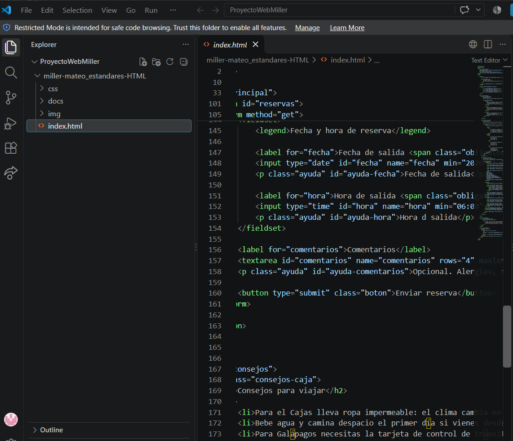
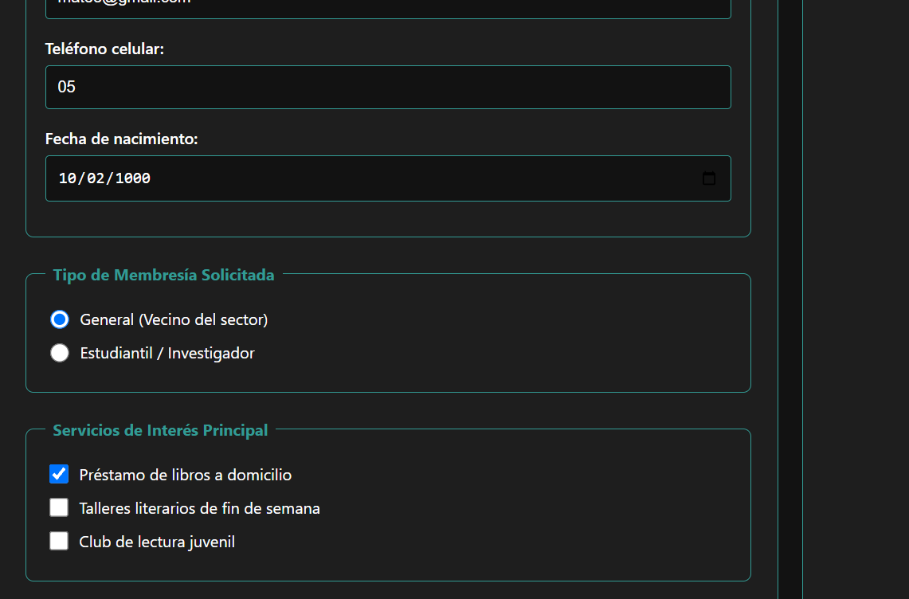
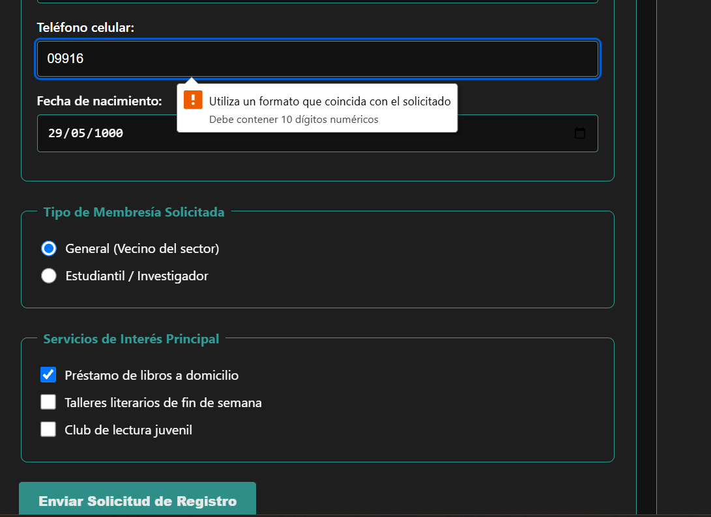
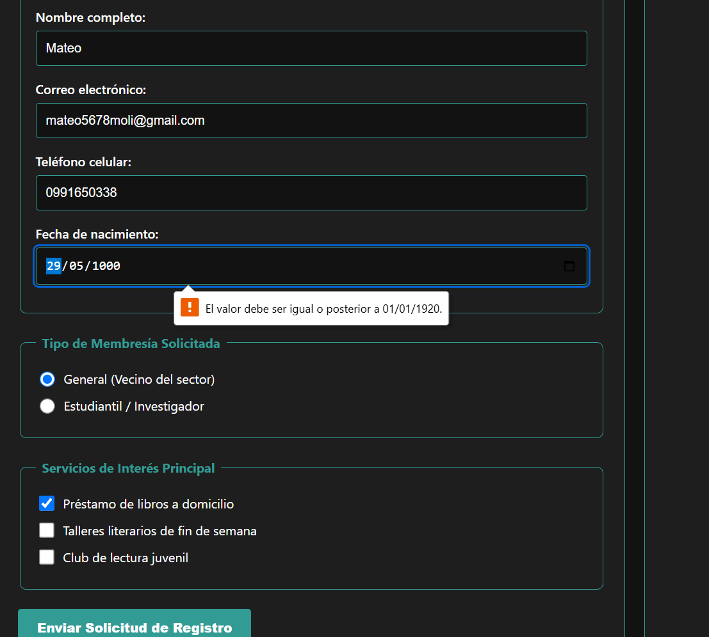

| N.º | Requisito | Ubicación | Hallazgo | Norma que incumple | Evidencia | Severidad |
|---|---|---|---|---|---|---|
| 1 | Ficha 16: Estilos impresión | `estilos.css` | Aunque los campos del formulario se ocultan correctamente al imprimir, el contenedor principal (título "Formulario de Registro de Socio" y su descripción) sigue visible, dejando una sección vacía y confusa en el papel. | Restricción Ficha 16 (cumplimiento parcial) / UX de impresión |  | Media |

### Verificaciones Aprobadas

* **Responsive a 600px (Restricción Ficha 16):**
  El diseño cambia correctamente de una sola columna a dos columnas de escritorio exactamente en el punto de quiebre de 600px comprobado en DevTools.
  
  

* **Accesibilidad de Formulario (Requisito Base 2):**
  Los grupos de `radio` y `checkbox` están envueltos correctamente en etiquetas `<fieldset>` con su respectivo `<legend>`. Además, los textos son clickeables porque los atributos `for` en los `<label>` coinciden perfectamente con los `id` de los `<input>`.
  
  

* **Validación W3C (Requisito Base 7):**
  El código HTML y CSS pasó sin errores de sintaxis en las herramientas oficiales del W3C Validator y CSS Jigsaw Validator.
  
  
  

* **Accesibilidad de Tabla (Requisito Base 3):**
  La tabla de datos utiliza correctamente la etiqueta semántica `<caption>` para el título y los encabezados `<th>` cuentan con el atributo `scope="col"` como dicta la norma.
  
  

* **Semántica e Imágenes (Requisito Base 8):**
  Las imágenes incluyen el atributo descriptivo `alt` obligatorio y están correctamente estructuradas usando las etiquetas semánticas `<figure>` y `<figcaption>`.
  
  