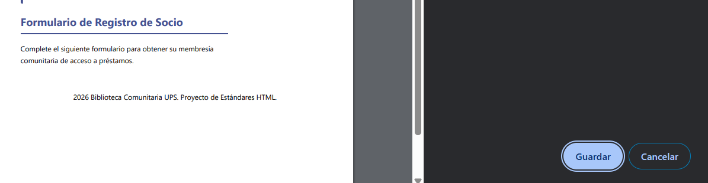
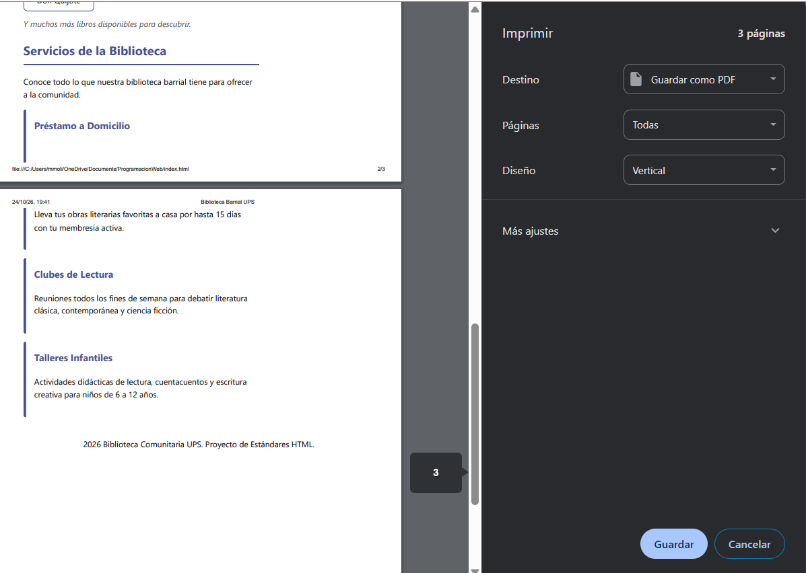

# Respuesta a la Auditoría y Correcciones Adicionales

**Estudiante:** Mateo Molina (N.º Lista 16)
**Auditor:** N.º Lista 17

## Respuestas al informe recibido

| N.º de hallazgo | Decisión | Justificación con la norma | Evidencia antes y después | Commit |
| :--- | :--- | :--- | :--- | :--- |
| 1 | **Acepta y corrige** | El auditor tiene razón. La Restricción de la Ficha 16 exige "ocultar el formulario". Al usar `display: none` solo en la etiqueta `<form>`, el título `<h2>` y la etiqueta `
` del contenedor quedaban huérfanos en la hoja de impresión. Se modificó el CSS para ocultar todo el contenedor `<section id="registro">`. |     | `fix: Ocultar sección completa de registro en modo impresión` |

## Problemas adicionales detectados y corregidos (Auto-auditoría)

Durante la revisión de mi propio código, detecté dos faltas al **Requisito Base 2** que mi auditor no notó, por lo que procedí a solucionarlas.

| N.º de hallazgo | Decisión | Justificación con la norma | Evidencia antes y después | Commit |
| :--- | :--- | :--- | :--- | :--- |
| 2 (Propio) | **Acepta y corrige** | El Requisito Base 2 exige "validación nativa (required, pattern, min/max)". Mi campo de teléfono solo tenía `required`. Le añadí el atributo `pattern="[0-9]{10}"` para forzar el formato celular ecuatoriano y evitar que el usuario ingrese letras. |     | `fix: Agregar validación pattern al campo de teléfono` |
| 3 (Propio) | **Acepta y corrige** | El Requisito Base 2 exige validación nativa (`min/max`). Mi campo `type="date"` de nacimiento estaba abierto a fechas irreales (ej. nacer en el año 2050). Se le añadieron los atributos `max="2014-12-31"` (para exigir mínimo 12 años) y `min="1920-01-01"`. |     | `fix: Limitar fechas min y max en el campo de nacimiento` |